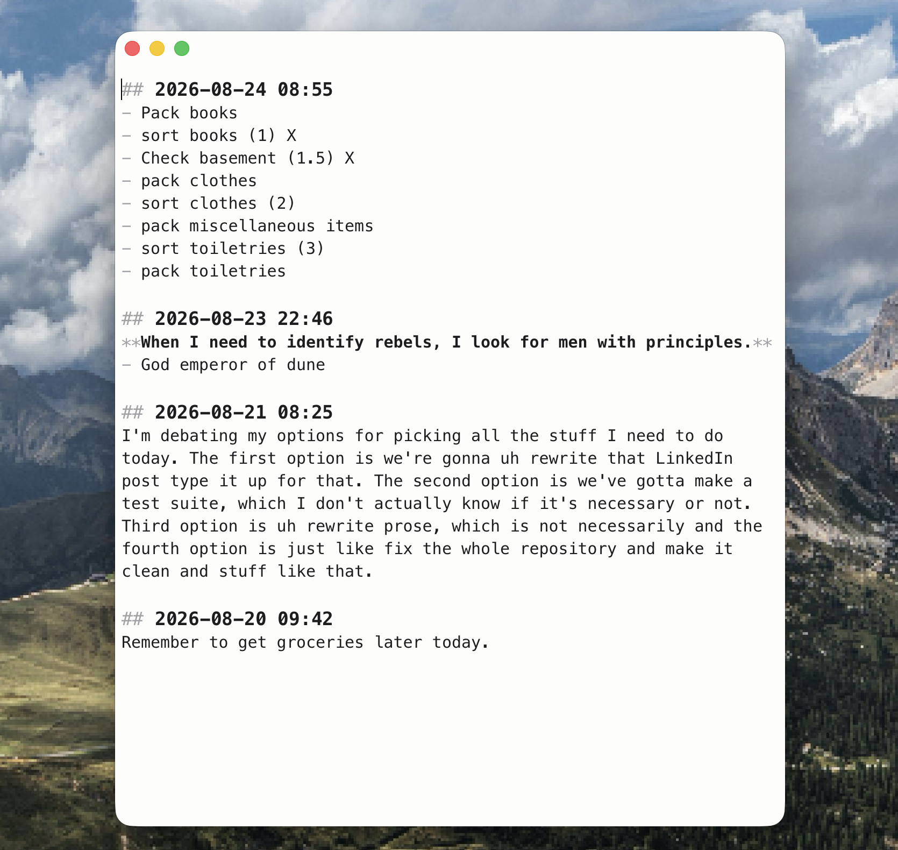

# Talkie

**The modern notepad.**

Set up one shortcut to immediately transcribe notes to a markdown file. It can be combined with an Openclaw instance to immediately speak to an agent, or used with Obsidian as a voice notes platform.



## Stable and Nightly

Talkie comes in two channels, installable side by side:

- **Talkie** — the stable release. [Latest release](https://github.com/haakon-kohler/Talkie/releases/latest).
- **Talkie Nightly** — the newest features first, with the inverted icon.
  Published from the `nightly` branch on every change; look for the
  prereleases on the [releases page](https://github.com/haakon-kohler/Talkie/releases).

Each keeps its own settings, model and permissions. Both write to
`~/Documents/Talkie/talkie.md` unless told otherwise, so give them different
shortcuts if you run both at once.

## Running it

Requires [Rust](https://rustup.rs/) (via rustup) and
[Trunk](https://trunkrs.dev/) (`cargo install trunk`). No node, no npm.

```sh
cargo tauri dev
```

`cargo tauri build` produces the `.app`/`.dmg`. Add
`--config src-tauri/tauri.nightly.conf.json` to either command for Talkie
Nightly.

## From a terminal

The capture pipeline also runs without the app, for scripts and for testing
hooks or whatever watches the file. The speech model has to be installed
first — open Talkie once.

```sh
Talkie transcribe <file.wav>                      # print the transcript
Talkie capture --wav <file.wav> [--note <path>]   # transcribe, then add it as a capture
Talkie capture --text <text> [--note <path>]      # add text as if it were a capture
```

`Talkie` is `/Applications/Talkie.app/Contents/MacOS/Talkie`. A capture runs the
`on-capture` and `after-capture` hooks and lands in the notes file from
settings unless `--note` names another. Stdout carries only the transcript or
what was written; the exit code is 0 on success, 1 on failure and 2 on a
malformed command.


# About

## Inspiration

Based on [Handy](https://github.com/cjpais/handy), a great FOSS app for voice transcription.

## Architecture

Rust end to end: [Tauri 2](https://tauri.app) hosting a
[Leptos](https://leptos.dev) CSR frontend compiled to WASM by Trunk. The one
piece of JavaScript is a frozen [CodeMirror 6](https://codemirror.net) bundle
behind a typed wasm-bindgen wrapper — see `ui/assets/vendor/README.md`.

Speech recognition uses Parakeet V3 through
[transcribe-rs](https://crates.io/crates/transcribe-rs); the audio capture,
resampling, and VAD code is ported from Handy (MIT) with its notice retained.

## License

PolyForm Noncommercial 1.0.0 — see `LICENSE`. The ported Handy audio code remains MIT.
